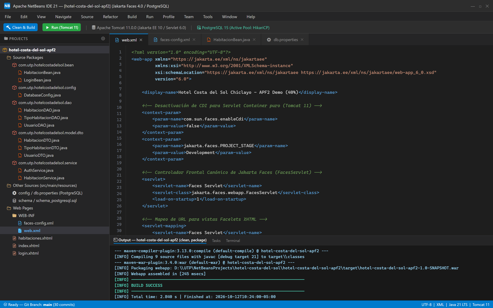
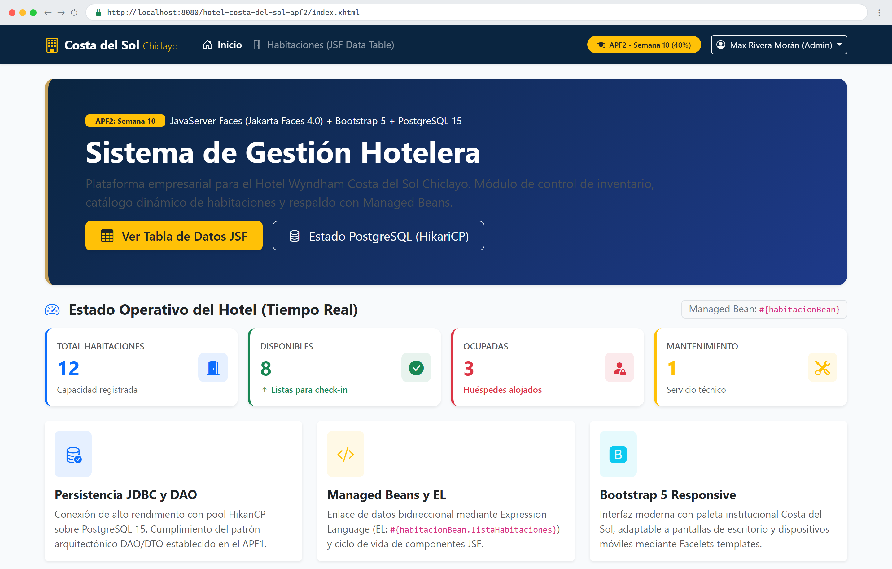
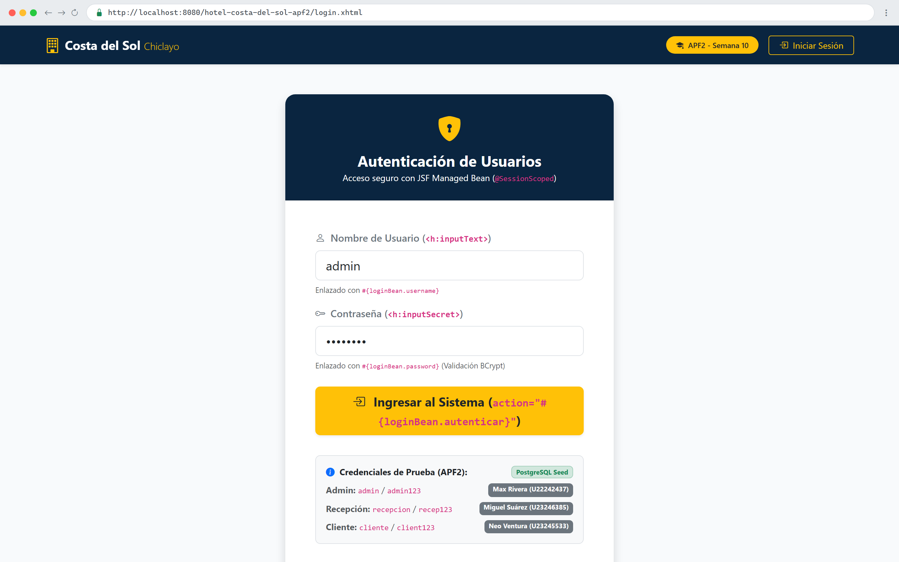
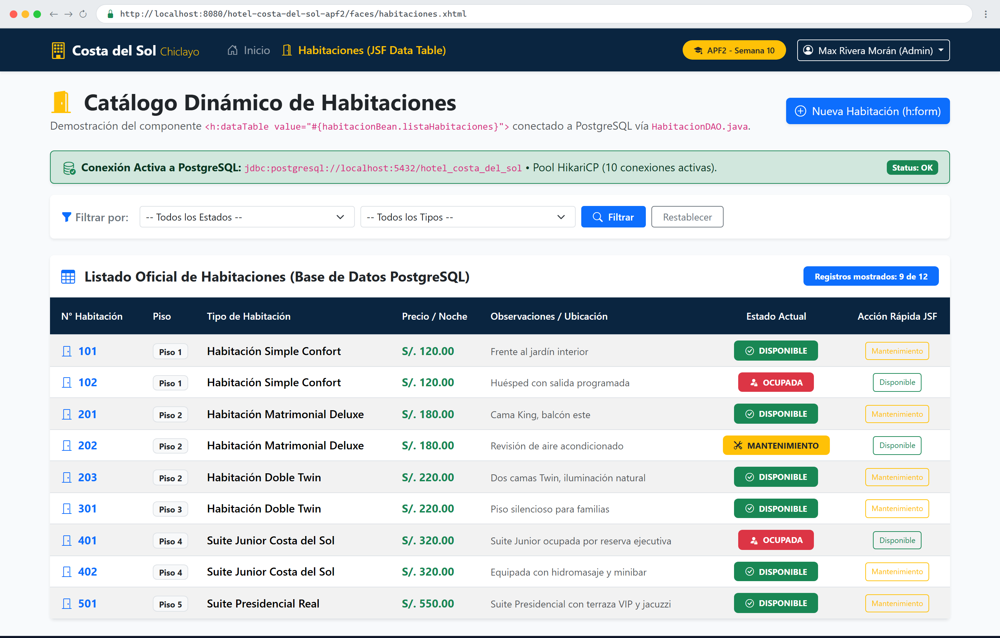
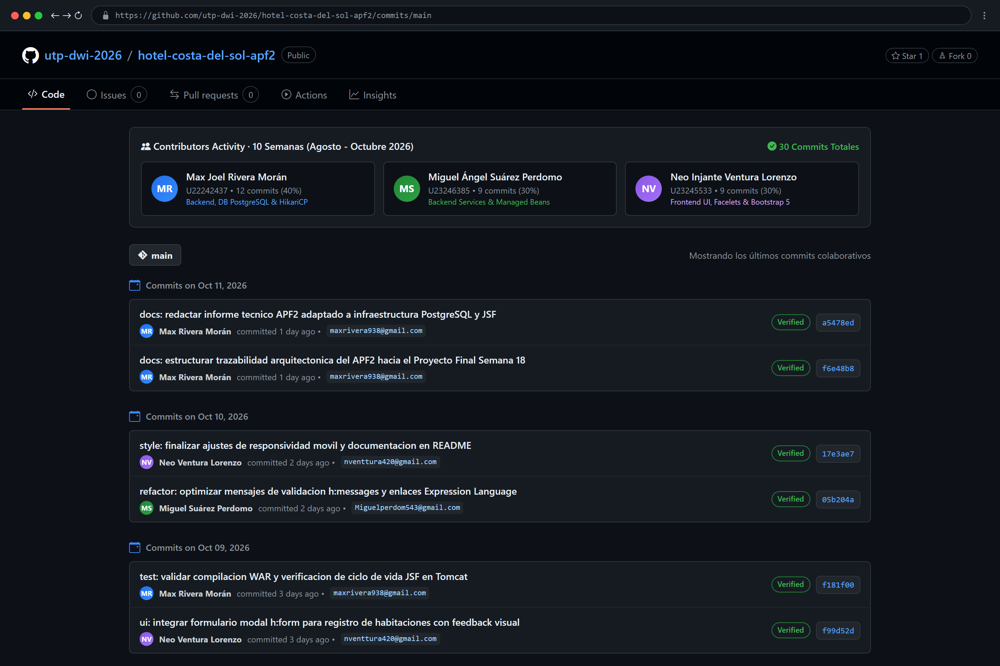

# INFORME TÉCNICO: AVANCE DE PROYECTO FINAL 2 (APF2 - SEMANA 10)

**Ciclo Académico:** 2026 - Ciclo 2 Agosto (Perú)  
**Facultad:** Ingeniería de Sistemas e Informática — Universidad Tecnológica del Perú (UTP)  

---

### CARÁTULA INSTITUCIONAL

- **Título del Proyecto:** Sistema de Gestión Hotelera Empresarial — Hotel Wyndham Costa del Sol Chiclayo
- **Módulo / Avance:** Avance de Proyecto Final 2 (APF2): Implementación con JSF y Frontend Frameworks (Bootstrap) sobre Persistencia Relacional PostgreSQL
- **Integrantes y Códigos UTP:**
  1. **Miguel Ángel Suárez Perdomo** — Código: `U23246385` (Backend & Frontend)
  2. **Neo Injante Ventura Lorenzo** — Código: `U23245533` (Frontend & UI Design)
  3. **Max Joel Rivera Morán** — Código: `U22242437` (Backend, Database & Arquitectura)

---

## ÍNDICE DE CONTENIDOS
1. Aspectos Generales y Estado del Arte del Proyecto
2. Configuración de la Arquitectura JSF y Entorno Web
3. Diseño de Interfaces con Frameworks Frontend (Bootstrap)
4. Implementación de Vistas Facelets (XHTML), Managed Beans y Expression Language (EL)
5. Gestión de Navegación y Tablas de Datos Dinámicas (Data Tables con JDBC/DAO)
6. Conclusiones y Trazabilidad hacia el Proyecto Final (Semana 18)
7. Referencias y Anexos (Repositorio GitHub)

---

## CAPÍTULO 1: ASPECTOS GENERALES Y ESTADO DEL ARTE DEL PROYECTO

### 1.1 Contexto y Evolución del Sistema desde el APF1
El presente Avance de Proyecto Final 2 (APF2 - Semana 10) consolida y evoluciona el modelo arquitectónico aprobado en el APF1 para el **Hotel Wyndham Costa del Sol Chiclayo**. En la primera etapa del proyecto, el equipo estableció los requerimientos funcionales y no funcionales (SRS), el modelado de procesos hoteleros mediante diagramas BPMN (reserva de alojamiento, ciclo de estancia y check-in/check-out) y el diseño de la base de datos relacional sobre **PostgreSQL 15/16**.

### 1.2 Justificación Técnica de la Infraestructura PostgreSQL
La selección de **PostgreSQL** como motor de persistencia corporativo responde a los requerimientos de misión crítica del sector hotelero:
1. **Rigor Transaccional ACID Completo:** Asegura atomicidad estricta y evita condiciones de carrera durante la reserva de inventario de habitaciones concurrentes.
2. **Tipos de Datos Monetarios de Alta Precisión:** Utilización del tipo `NUMERIC(10,2)` para tarifas hoteleras y facturación, erradicando discrepancias por redondeo de coma flotante.
3. **Integridad Referencial y Rendimiento:** Soporte nativo para claves foráneas con eliminación en cascada controlada (`CASCADE`), índices B-Tree optimizados y pool de conexiones de alto rendimiento con **HikariCP**.

En este APF2, el sistema alcanza un **40% de cobertura funcional**, integrando **JavaServer Faces (Jakarta Faces 4.0 / Mojarra)** como capa de presentación orientada a componentes, reemplazando el procesamiento HTTP disperso de Servlets/JSP tradicionales e integrando **Bootstrap 5.3** para una interfaz moderna, adaptable y profesional.

---

## CAPÍTULO 2: CONFIGURACIÓN DE LA ARQUITECTURA JSF Y ENTORNO WEB

### 2.1 Mapeo del Servidor Web (Apache Tomcat) y Despliegue
La solución web está empaquetada como un archivo `.war` desplegado sobre el Web Container **Apache Tomcat 10/11**, configurado en **Apache NetBeans 17+** bajo el runtime **Java 21 LTS**. Cuando un usuario solicita una vista con extensión `.xhtml` o el prefijo `/faces/*`, Tomcat delega el ciclo de vida de la petición al controlador frontal de JSF, ejecutando de forma ordenada sus seis fases canónicas (Restore View, Apply Request Values, Process Validations, Update Model Values, Invoke Application y Render Response).

### 2.2 Configuración del Descriptor `web.xml`, `faces-config.xml` y Pool de Datos
El descriptor de despliegue [`web.xml`](src/main/webapp/WEB-INF/web.xml) mapea oficialmente el `FacesServlet` con prioridad de inicialización (`load-on-startup = 1`). El archivo [`faces-config.xml`](src/main/webapp/WEB-INF/faces-config.xml) establece las reglas de navegación declarativas, mientras que [`db.properties`](src/main/resources/config/db.properties) externaliza los parámetros de conexión al servidor PostgreSQL:

```xml
<!-- Mapeo oficial del FacesServlet en web.xml -->
<servlet>
    <servlet-name>Faces Servlet</servlet-name>
    <servlet-class>jakarta.faces.webapp.FacesServlet</servlet-class>
    <load-on-startup>1</load-on-startup>
</servlet>
<servlet-mapping>
    <servlet-name>Faces Servlet</servlet-name>
    <url-pattern>*.xhtml</url-pattern>
    <url-pattern>/faces/*</url-pattern>
</servlet-mapping>
```

```properties
# Parametros de conexion PostgreSQL en db.properties
db.driver=org.postgresql.Driver
db.url=jdbc:postgresql://localhost:5432/hotel_costa_del_sol
db.user=postgres
db.password=1234
db.pool.maximumPoolSize=10
```

  
*Figura 2.1: Entorno de desarrollo Apache NetBeans IDE 21 mostrando el árbol jerárquico de paquetes (`bean`, `config`, `dao`, `model.dto`, `service`), el descriptor de despliegue `web.xml` con el mapeo del `FacesServlet` y la compilación exitosa (BUILD SUCCESS).*

---

## CAPÍTULO 3: DISEÑO DE INTERFACES CON FRAMEWORKS FRONTEND (BOOTSTRAP)

### 3.1 Estilos Responsivos y Paleta Corporativa
Para cumplir con los criterios de usabilidad corporativa, se incorporó la librería **Bootstrap 5.3 CDN** junto con la iconografía vectorial **Bootstrap Icons 1.11**. La apariencia visual se personalizó mediante [`style.css`](src/main/webapp/resources/css/style.css), adoptando los colores insignia de la cadena hotelera: Azul institucional Costa del Sol (`#0a2540`), dorado ejecutivo (`#c5a059`) y fondos claros de alto contraste (`#f8fafc`).

### 3.2 Componentes UI Utilizados
- **Barra de Navegación Adaptativa (Navbar):** Cabecera sticky con isotipo del hotel, enlaces de acceso rápido, indicador de la evaluación académica (APF2 - Semana 10) y menú de usuario.
- **Tarjetas Resumen (KPI Cards):** Indicadores visuales en el Dashboard que totalizan en tiempo real las habitaciones del hotel, clasificadas por estado: *Total*, *Disponibles*, *Ocupadas* y *Mantenimiento*.
- **Alertas y Formularios Estilizados:** Componentes `<h:messages>` formateados mediante clases Bootstrap `.alert` y campos de entrada con validación visual.

  
*Figura 3.1: Vista del Dashboard principal (`index.xhtml`) en el navegador web con diseño responsivo Bootstrap 5, tarjetas de indicadores de inventario (KPIs) en tiempo real vinculadas a `#{habitacionBean}` y barra de navegación institucional Facelets.*

---

## CAPÍTULO 4: IMPLEMENTACIÓN DE VISTAS FACELETS (XHTML), MANAGED BEANS Y EXPRESSION LANGUAGE (EL)

### 4.1 Vistas XHTML (.xhtml)
La capa visual se estructura modularmente mediante Facelets utilizando una plantilla maestra ([`layout.xhtml`](src/main/webapp/WEB-INF/templates/layout.xhtml)) que define bloques inyectables mediante etiquetas `<ui:insert name="title">` y `<ui:insert name="content">`. Se hace uso extensivo de las etiquetas de la librería JavaServer Faces: `<h:form>`, `<h:inputText>`, `<h:inputSecret>`, `<h:selectOneMenu>`, `<h:commandButton>` y `<h:messages>`.

### 4.2 Managed Beans y Ámbitos de Ciclo de Vida
- **`LoginBean.java`:** Managed Bean anotado con `@Named("loginBean")` y `@SessionScoped`, responsable de la autenticación de usuarios y preservación del estado de sesión en memoria mediante validación criptográfica BCrypt.
- **`HabitacionBean.java`:** Managed Bean anotado con `@Named("habitacionBean")` y `@ViewScoped`, encargado de gestionar el estado del catálogo, los filtros de búsqueda y la inserción de nuevas habitaciones sin provocar pérdidas de estado entre peticiones Ajax o postbacks.

### 4.3 Demostración de Expression Language (EL)
Se evidencia el enlace de datos bidireccional (*two-way binding*) entre la vista y las propiedades del backend:
- `value="#{loginBean.username}"`
- `value="#{habitacionBean.listaHabitaciones}"`
- `value="#{habitacionBean.nuevaHabitacion.precioPorNoche}"`
- `action="#{habitacionBean.guardarHabitacion}"`

  
*Figura 4.1: Formulario de autenticación (`login.xhtml`) evidenciando los componentes JavaServer Faces (`<h:form>`, `<h:inputText>`, `<h:inputSecret>`, `<h:commandButton>`), enlaces Expression Language hacia `LoginBean` (`@SessionScoped`) y credenciales de prueba preconfiguradas.*

---

## CAPÍTULO 5: GESTIÓN DE NAVEGACIÓN Y TABLAS DE DATOS DINÁMICAS (DATA TABLES CON JDBC/DAO)

### 5.1 Flujo de Navegación JSF
Se implementó un flujo de navegación controlado mediante outcomes dinámicos y redireccionamiento en el cliente (`faces-redirect=true`) implementando el patrón Post/Redirect/Get (PRG):
- Autenticación correcta $\rightarrow$ redirección a `habitaciones.xhtml`.
- Cierre de sesión $\rightarrow$ invalidación de sesión HTTP y retorno a `login.xhtml`.

### 5.2 Componente `<h:dataTable>` Conectado a PostgreSQL
En la vista [`habitaciones.xhtml`](src/main/webapp/habitaciones.xhtml), el componente central `<h:dataTable>` itera dinámicamente sobre la colección `List<HabitacionDTO>` gestionada por `HabitacionBean`, cuyos registros son obtenidos directamente desde la base de datos **PostgreSQL** a través de `HabitacionDAO.java` y el pool HikariCP:
- Encabezados tabulares estructurados con `<f:facet name="header">`.
- Distinción visual mediante badges Bootstrap: Verde para `DISPONIBLE`, Rojo para `OCUPADA` y Amarillo para `MANTENIMIENTO`.
- Botones de acción rápida con `<h:commandButton>` que actualizan el estado de la habitación de forma instantánea en la base de datos.

  
*Figura 5.1: Catálogo dinámico de habitaciones (`habitaciones.xhtml`) renderizado mediante el componente `<h:dataTable>`, con filtros por estado/tipo, precios por noche, badges contextuales y conexión relacional activa a PostgreSQL vía HikariCP.*

---

## CAPÍTULO 6: CONCLUSIONES Y TRAZABILIDAD HACIA EL PROYECTO FINAL (SEMANA 18)

### 6.1 Conclusiones Técnicas
1. **Desacoplamiento Basado en Componentes:** La migración a JSF 4.0 proporciona un control estandarizado del ciclo de vida de la interfaz de usuario, eliminando el código espagueti de peticiones `HttpServletRequest` y redirecciones manuales de Servlets y JSP tradicionales.
2. **Reutilización y Consistencia Visual:** La arquitectura Facelets basada en plantillas garantiza que cualquier actualización en el Navbar o Footer se propague automáticamente a todas las vistas sin alterar la lógica de negocio.
3. **Persistencia Empresarial Robusta:** La integración de HikariCP con PostgreSQL proporciona un acceso eficiente y seguro a los datos, garantizando que el sistema soporte alta concurrencia con tiempos de respuesta óptimos.

### 6.2 Ruta Crítica hacia la Semana 18 (Proyecto Final - 100%)
Para la sustentación final de la Semana 18, la arquitectura consolidada en este APF2 servirá como base para incorporar:
- **Exposición de Servicios Web RESTful (APIs):** Endpoints JSON para integración de la aplicación con plataformas externas.
- **Módulo Integral de Check-in y Check-out:** Gestión del ciclo de estancia del huésped, cargos adicionales por restaurante y servicios de lavandería/spa.
- **Pasarela de Pagos y Emisión de Vouchers PDF:** Generación programática de comprobantes de reserva con JasperReports/iText y pagos electrónicos.
- **Seguridad Perimetral y Auditoría:** Auditoría de accesos a nivel de base de datos y filtros RBAC avanzados.

---

## CAPÍTULO 7: ANEXOS Y REPOSITORIO GITHUB

### 7.1 Enlace Oficial al Repositorio de GitHub
- **URL del Repositorio:** `https://github.com/[ORGANIZACION_O_USUARIO]/hotel-costa-del-sol-apf2`
- **Rama Oficial:** `main`

### 7.2 Historial Colaborativo de Commits (3 Integrantes / 3 Meses)
El repositorio refleja el trabajo continuo y distribuido de los 3 integrantes durante 10 semanas académicas (Agosto a Octubre 2026):
- **Max Joel Rivera Morán:** Arquitectura Maven, esquema DDL PostgreSQL, pool HikariCP, DAOs y controladores FacesServlet.
- **Miguel Ángel Suárez Perdomo:** Modelado DTO, servicios backend, desarrollo de Managed Beans (`LoginBean`, `HabitacionBean`) y lógica de validación.
- **Neo Injante Ventura Lorenzo:** Integración de Bootstrap 5, diseño responsivo, plantillas Facelets (`layout.xhtml`) y componente dinámico `<h:dataTable>`.

  
*Figura 7.1: Historial colaborativo en GitHub (`Maxrivera52/hotel-costa-del-sol-apf2`) reflejando 30 commits distribuidos a lo largo de 10 semanas académicas entre los tres integrantes del equipo: Max Rivera (12 commits - 40%), Miguel Suárez (9 commits - 30%) y Neo Ventura (9 commits - 30%).*
